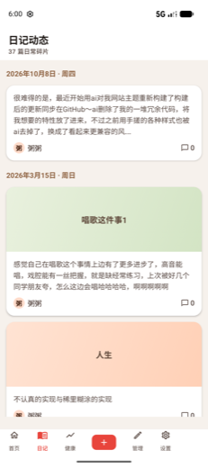
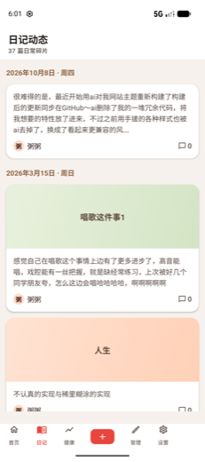
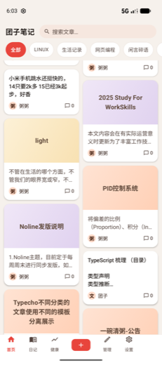

# NLecho

一个给 [Typecho](https://typecho.org/) 博客用的原生 Android 客户端：**Kotlin + Jetpack Compose + Material 3**，数据全部走 Typecho 自带的 XML-RPC 接口，不依赖任何服务端插件就能看文章、写文章、管评论。

界面没有用 Material 默认那套（药丸高亮、tone 容器、TopAppBar），而是**深度仿小红书**：双列瀑布流、单列大图日记、笔记式详情页、自绘底部导航 + 居中的「+ 发布」方块。

它是我给自己博客（团子笔记）写的日常用 App，所以「一个博主 + 一台手机」这条路径上的细节做得比较满：离线补交、文章缓存、图片压缩上传、字体缩放全局生效。

想直接装：[Releases](https://github.com/qine233/typecho-app/releases/latest) 里有 CI 打好的 debug 包（Android 8.0+ 可装）。

| 首页：双列瀑布流 + 分类筛选条 | 日记动态：按日期分组的单列大图 | 详情页：笔记式正文 + 固定互动栏 |
| --- | --- | --- |
|  |  |  |

## 能做什么

**阅读**
- 首页双列瀑布流，顶部搜索药丸 + 分类横向筛选条；翻页走站点真实分页参数，配骨架屏与进场动画
- 「日记动态」标签：把归在日记分类下的文章按日期倒序排成时间线，单列大图
- 详情页：多图 `HorizontalPager` 轮播 + 全屏查看器、正文图片懒加载、评论按 `parentId` 还原成嵌套回复树
- 底部固定互动栏：赞 / 收藏 / 评论入口，点赞收藏状态写本机，下次进来还在

**写作与管理**（登录账号是管理员时才会出现「管理」标签）
- 编辑器：Markdown 正文 + 实时预览、撤销/重做、全屏沉浸写作、分类与标签、存草稿
- 发布时间：高级选项里能挑日期和时间（新建默认此刻、编辑默认沿用原文时间），保存时原样送回站点，改老文章不会再被顺手顶到最新
- 发布之后会把站点回传的编号认回本篇，接着改就是原地编辑，不会再插第二篇（本站小回复会被 PHP 警告吃掉，认不回来时会明确提示，详见「PHP 8.4 的 warning 会吃掉小回复」）
- 编辑器本地自动存稿：输入停顿即落盘，进程被杀或闪退后重进会问一句要不要恢复
- 插图：从相册选图 → 本地压缩 → 上传 → 正文内联；配了 Cloudreve 就走 Cloudreve 拿永久直链，没配则走 `metaWeblog.newMediaObject`
- 管理台：文章列表（发布/草稿/私密状态切换、删除）、评论审核（通过 / 垃圾 / 删除 / 回复）、页面列表
- 网盘：配了 Cloudreve 就能在「管理 → 网盘」里浏览目录、看已用容量、传本地文件、下载回本机、建文件夹、重命名、移动、丢回收站，并给任意文件手动生成永久直链或一条带提取码的分享（详见「网盘管理」）
- 存稿/发布/删除之后，首页、日记、管理列表当场跟着重取，不用退出 App 重进

**健康记录**（可选，需要站点装 NoLineApi 插件，见下）
- 体重 / 体脂率按天记录，概览页给出当前值、BMI、目标进度、7/30/90 天变化与趋势折线图
- 断网时先进本机队列，恢复后自动补交；接口按天整体覆盖，重放安全

**买菜记账**（可选，同一个插件、同一个开关，入口在「健康」页顶部）
- 概览一屏读完：本月大额 + 涨跌、本周/本年/累计、近 7 个月柱状（空月也补零画出来）、本月分类占比、最近 12 天流水
- 「再加一样」一次买多样，合并成**一个**批量 POST；点分类 chip 就地按类筛本月流水，点任一行可改可删
- 涨跌是客户端算的（接口不做差），上周为空时画「—」而不是「省了本期全部」；本周/本月都带「3/7 天」这种已过天数标注，不会把没过完的区间当整段比
- 离线记账走本机队列：新增合并成一个批量 POST、拿到服务器返回的编号才算提交成功（没有编号的行改不了也删不了），修改走幂等 PUT，删除撞上「本来就没这条」当成功放过

**通用**
- 深色模式（跟随系统 / 浅色 / 深色）、字体缩放（全局生效，包括正文渲染区）
- 文章列表持久化缓存，冷启动先出内容再刷新
- 设置 → 检测更新：问 GitHub Releases 要最新版，有更新就下 apk 交给系统安装器；下载可选 GitHub 镜像站加速，下完对 sha256
- 设置 → 数据与存储：按「安装包 / 图片缓存 / 更新包 / 文章缓存 / 其他缓存 / 本地草稿 / 待同步记录 / 账号数据」分类列出实际占用并画成占比条，缓存可单类清理或一键全清；草稿和待同步队列只报数、给逐条删除和立即补交，永远不进「清理缓存」，不会被顺手清掉
- 退出登录会清掉本机保存的凭证

## 技术栈

| | |
| --- | --- |
| 语言 / UI | Kotlin 2.1、Jetpack Compose（compose-bom 2024.12.01）、Material 3 |
| 架构 | 单 Activity + Navigation-Compose；`AppContainer` 手写依赖注入；ViewModel + StateFlow |
| 网络 | OkHttp 4.12；XML-RPC 自己实现（`XmlRpcClient` 手写编解码，无第三方 XML-RPC 库）；NoLine / Cloudreve 走 kotlinx.serialization |
| 图片 | Coil 3 |
| 存储 | DataStore Preferences（配置、互动状态）、Android Keystore AES-256-GCM（接口密钥、图床密码）、JSON 文件（文章缓存 / 健康与记账离线队列 / 记账概览与品名候选） |
| 构建 | AGP 8.7.3、Gradle 8.9 wrapper、JDK 17、minSdk 26 / target & compileSdk 35 |
| 测试 | JUnit 4 + kotlinx.serialization，138 个单元测试（`app/src/test`） |

## 目录结构

```
app/src/main/java/noline/zhouzhou/
├── MainActivity.kt / AppContainer.kt      # 单 Activity + 依赖容器
├── data/
│   ├── model/       # Post / Comment / HealthOverview 等数据类
│   ├── remote/      # XmlRpcClient（协议编解码）、TypechoApi（业务方法）、NolineApi / CloudreveApi（REST）
│   └── repository/  # 缓存、密钥、离线队列、各业务的仓库层
└── ui/
    ├── navigation/  # NavGraph + 自绘 TypechoTabBar
    ├── components/  # 卡片、评论项、小红书式头部/引导文案
    ├── screens/     # home / diary / post / editor / admin / health / bills / settings / login
    └── theme/       # 配色（暖棕强调色 + 灰底白卡）、字体
```

## 快速开始

```bash
git clone https://github.com/qine233/typecho-app.git
cd typecho-app
# 指向本机 Android SDK（这个文件已在 .gitignore 里）
echo "sdk.dir=$HOME/Library/Android/sdk" > local.properties
./gradlew assembleDebug        # 产物：app/build/outputs/apk/debug/app-debug.apk
adb install -r app/build/outputs/apk/debug/app-debug.apk
```

需要 JDK 17 和 Android SDK 35。包名 `noline.zhouzhou`，debug 构建带 `.debug` 后缀（`noline.zhouzhou.debug`），可以和 release 并存。

跑测试：

```bash
./gradlew testDebugUnitTest
```

## 自动构建与下载

`.github/workflows/build-apk.yml` 在 GitHub 上跑编译，不用本地装 Android Studio：

| 触发 | 结果 |
| --- | --- |
| 推 `v*` 标签（如 `v1.0.0`） | 建 Release，把 APK 作为附件挂上去，可直接下载装机 |
| push 到 `main` / PR / 手动 Run workflow | 只跑测试 + 编译，APK 放在那次运行的 **Artifacts** 里 |

所以想要一个能装的新包：合并到 `main` 后去 Actions 页面拿 Artifacts；想给外人一个稳定入口，就打 tag。

应用内「检测更新」按 tag 的数字段比版本（`v1.0.1` 与 `1.0.1` 等价），并且**只认同渠道的附件**：debug 包名里带 `debug`，正式包不带。渠道不对时提示「没有本机这个渠道的包」而不是硬下——包名和签名都对不上，下回来也装不进正在跑的这份。

### 下载走 GitHub 镜像

直连 `objects.githubusercontent.com` 拉 19 MB 的包，在这台机器上 240 秒只挪了 6.5 MB（约 27 KB/s），而 `api.github.com` 一次几百字节的请求 0.7 秒就回。所以**查版本仍走官方接口，只有下载 apk 这一步需要镜像**：设置 → 检测更新 → 「更新来源」里选一家，选中的排最前，失败或校验对不上会自动换下一家。

`GithubMirror` 里现在有四家，2026-10-15 用 `v1.0.8` 的包逐个实测过（取首块认 `PK\x03\x04`，再整包下完对 sha256）：

| 来源 | 下载附件 | 转发 `api.github.com` | 整包耗时 |
| --- | --- | --- | --- |
| GitHub 直连 | 慢 | 0.7s | 240s 没下完 |
| `gh-proxy.com` | 通 | 通 | 3.5s |
| `ghfast.top` | 通 | 403，只转文件 | 12s |
| `ghproxy.net` | 通但很慢 | 403，只转文件 | 240s 没下完 |

地址是前缀拼接：`https://gh-proxy.com/` + 原始 `https://github.com/...` 或 `https://api.github.com/...`。另外探过但没收的：`github.moeyy.xyz`、`gh.llkk.cc`、`mirror.ghproxy.com`、`ghp.ci`、`hub.gitmirror.com` 连不上，`gh.con.sh`、`gitproxy.click`、`ghproxy.cn`、`dlink.host` 回的是 HTML 页面。镜像站是会换的，所以来源列表要定期重测，代码里那两条兜底链（`apiChain()` / `downloadChain()`）就是为一家死了准备的。

**镜像下来的包一定要对校验和**：GitHub 接口的附件里带 `digest`（形如 `sha256:dc9b…`），`UpdateRepository.download` 下完会重算并比对，另外还看首 4 字节是不是 zip 的 `PK\x03\x04`、大小跟接口报的一不一致，任一项不对就换下一个来源。实测 `gh-proxy.com` 与 `ghfast.top` 下到的包 sha256 与接口 `digest` 完全一致。要点是：**校验和来自接口那一次请求**，所以接口只走 `apiChain()`（直连优先，挂了才轮到能转发接口的 `gh-proxy.com`），不受这里选的下载来源影响。直连拿到接口时，sha256 是 GitHub 说的，镜像换包必然对不上；只剩接口也走镜像这种极端情况，这份校验和就只拦得住截断和 HTML 错误页，拦不住主动作恶——真要把这条链彻底锁死，得给发布物做签名清单（`minisign` 之类）再随仓库分发公钥。

签名这块有个坑值得记一下：Actions 每台 runner 都是新的，`~/.android/debug.keystore` 当场现生成，所以早期每个 Release 的 APK 签名都不一样，App 内下载完交给安装器只会得到 `INSTALL_FAILED_UPDATE_INCOMPATIBLE`。现在 `keystore/debug.keystore` 提交在仓库里，本机与 CI 都用它签（口令就是 Android 通用的 `android`/`androiddebugkey`），发布出去的包才互相覆盖得了。**装了 `v1.0.1` 及更早的包要先卸载一次**，那两版是临时密钥签的，跟这份对不上。要出正式签名的 release 包，需要自己补两步：

1. 仓库 Settings → Secrets and variables → Actions 里加 `KEYSTORE_BASE64`（`base64 -w0 your.jks` 的结果）、`KEYSTORE_PASSWORD`、`KEY_ALIAS`、`KEY_PASSWORD`
2. `app/build.gradle.kts` 的 `release` 里加 `signingConfig`，从上面几个 secret 读，再在工作流里加一步 `assembleRelease` 并把产物一起上传

仓库里那份只是 debug 密钥，作用就是让同一渠道的包能互相覆盖升级；正式签名的私钥仍然不要提交，一旦进过仓库历史就收不回来。

## 登录：直连站点自带的 XML-RPC

App 只认站点自己的 XML-RPC 端点，不需要额外配置。

1. 登录页填三项：
   - **站点地址**：`https://your-blog.com`（必须 HTTPS —— `network_security_config` 关掉了明文流量，http 站点会被系统直接掐断）
   - **XML-RPC 路径**：默认 `/action/xmlrpc`，改过伪静态的按实际填
   - **用户名 / 密码**：Typecho 账号
2. 「记住登录状态」勾上才会把密码留在本机（DataStore 明文，见「已知限制」）

XML-RPC 是 Typecho 核心自带的（`var/Widget/XmlRpc.php`，路由 `do(action='xmlrpc')`），后台没有开关，装了站点就能直连。

登录时先调 `blogger.getUsersBlogs` 验证，并从返回里读 `isAdmin`，决定要不要给你看「管理」和「健康」标签。

用到的接口方法：`blogger.getUsersBlogs` / `blogger.deletePost`、`metaWeblog.getRecentPosts` / `getPost` / `newPost` / `editPost` / `getCategories` / `newMediaObject`、`wp.getComments` / `newComment` / `editComment` / `deleteComment` / `getPages`。

> Typecho 的 XML-RPC 和 WordPress 有几处不一致（参数顺序、`post_status` 命名、PHP 8 的 warning 会混进响应头），`XmlRpcClient` 里都按 Typecho 的实际行为处理了。

### PHP 8.4 的 warning 会吃掉小回复

站上跑 PHP 8.4 时，XML-RPC 的响应体前面会多出一段固定的 228 字节 deprecation 提示（`xml_set_object()` 那条），但 `Content-Length` 头是按不含警告的纯 XML 长度算的。客户端按这个长度读，读到的 XML 就比实际少 228 字节：

- 回复体超过 228 字节的没事，只是尾巴被截掉一截，`XmlRpcClient` 会先把警告前缀剥掉再解析
- **XML 本身不足 228 字节的，一个字节都读不到** —— `metaWeblog.newPost` 只回一个数字 cid（约 140 字节）、`metaWeblog.editPost` 只回 `<boolean>1</boolean>`，正好都在这一档里

所以发布成功但客户端拿不到新编号，看起来就像「同一篇发两次、多出一篇重复的」。App 侧的处理是：先认站点回传的 cid，拿不到就立刻用 `metaWeblog.getRecentPosts` 取最新一篇，标题能对上就把它当成本篇的编号（页面走 `wp.getPages`）；连这一步也认不回来时，Toast 会明说「站点没有回传编号」，提醒从列表里继续编辑而不是再点一次发布。

**站点侧改了更彻底**：在宝塔的 PHP 8.4 配置里把 `display_errors` 设为 `Off`（或从 `error_reporting` 里去掉 `E_DEPRECATED`），warning 就不再进响应体，小回复立刻恢复正常长度。改完 `metaWeblog.newPost` / `editPost` 的返回值才真正读得到，不用依赖上面这层兜底。

## 健康记录与买菜记账：需要 NoLineApi 插件

这两个功能是可选的，不装插件其余功能照常。「健康」标签只对管理员账号显示，读者账号看不到；记账入口在「健康」页顶部的「买菜记账」胶囊里，不占底部第六个标签。没配好接口时点进去是一页配置引导，不会白屏。前提是站点装了配套的 `NolineApi` Typecho 插件（REST 端点：`ping`、`theme`、`health`、`health/records`、`bills`、`bills/records`）。

配置四步：

1. 后台装好并启用 NolineApi 插件
2. App 设置 →「健康记录接口」→ 填接口密钥（和插件里配的那把一致）
3. 只想在 App 里看不记的话，后台别开「允许写入」；要记就打开
4. 点「保存并自检」

自检会真的跑一遍读写：先按 `/api/…` → `/index.php/api/…` → `/?noline_api=…` 三种 URL 形态探测出可用的一种并记住，再发一次读取和一次「必定无效」的写入探针（weight 0，服务端会直接拒掉，不落库），从而区分「密钥错」「站点关了」「只读」「路径不通」。结果卡片会用不同文案告诉你卡在哪一步，包括把服务器原话和解析报错分开显示。

写记录前 App 本地先校验：日期必须是不晚于今天的 `yyyy-MM-dd`（严格解析，`2026-02-30` 这种会被拒）、体重在 20–400 kg、体脂率异常只提示不拦。

记账这边和体重有几处规矩不一样，都是对着插件源码（`plugins/NolineApi/Bills.php`）核过的：

- POST **永远新增**，没有「同日覆盖」，所以离线重放必须先攒着、合并成一次批量提交，不能像体重那样随手重发。
- 批量提交的响应里 `ids[]` 是按「通过校验的那几条」同序给的，App 必须把它认回本地条目 —— 没有服务器编号的行既改不了也删不了；`invalid[]` 装的是**品名**（截到 20 字），不是体重那边的日期。
- PUT 要在 body 里带 `id`（缺了 400、查无此条 404），改了日期 `id` 也不变，所以日期不能从 `id` 反推；`time` 一直是当初录入那一刻，`updated` 为 0 表示从没改过。
- DELETE 的 `id` 在 **query** 里；查无此条回 404，客户端按删除成功放过（重放第二次就是这个）。
- 分类代码是稳定的 8 项（`veg/fruit/meat/fish/egg/grain/seasoning/other`），写错的代码服务器**静默**归到 `other`，所以选择器只给这 8 个，标签由 App 自己出。
- `GET /api/bills/records` 的 `limit` 默认 50，取的是区间**尾部** 50 条，而响应里的 `amount` 只算真返回的那些 —— 要整月合计必须显式传 `limit=0`。
- 一条流水都没有时，六个区间（`totals`/`week`/`prev_week`/`month`/`prev_month`/`year`）和 `max` 都是显式 `null`，不是「金额为 0」。

## 插图图床：可选接 Cloudreve v4

不配也能用，插图照旧走博客自己的 XML-RPC 附件上传。配了之后编辑器只认 Cloudreve —— 悄悄退回旧通道只会让人以为图床没坏，所以当场报错更实在。

配置：设置 →「图片上传图床」→ 填 Cloudreve 地址 + 登录邮箱 + 密码 → 点「保存并自检」。自检只试一次登录，不往云端写任何东西；密码和 NoLine 密钥一样经 Keystore 加密后存本机。图片落在 `/blog/<年>/<月>/<毫秒时间戳>.jpg`（目录名在 `CloudreveRepository.ImageDir`，暂时没有界面可改），路径上缺的年月目录由 Cloudreve 顺手建出来。

v4 有几个和直觉不符的地方，都是对着源码核过的：

- **没有「长期 API 密钥」**。`Authorization: Bearer Cr…` 那种是请求签名，进不去文件接口；能用的只有 `POST /api/v4/session/token` 换出来的 JWT，默认一小时过期。所以 App 存的是账号密码，令牌快到期或撞上鉴权类错误码就重登一次（只重登一次，不循环）。
- **直链只能用 `PUT /api/v4/file/source`**。它给的 `/f/<id>/<name>` 游客也能打开，服务端每次 302 到一个新鲜签名的地址，贴进文章不会失效。`POST /api/v4/file/url` 的签名地址默认一小时就过期，而且过期后照样回 HTTP 200 + `{"code":40005}` —— 用它贴图，文章里的图会在一小时后无声消失。
- **状态码没有信息量**。连「未登录」都是 HTTP 200，成败只看响应体的 `code`，所以只有返回的不是 JSON 时才拿状态码兜底。
- **`PUT /api/v4/file/content` 不是上传口**。它是在线编辑器改文件内容用的，拿它上传会撞上 `{"code":50004}`。真正的上传一定是三步：`PUT /api/v4/file/upload?uri=…` 建会话 → 按会话给的 `chunk_size` 分片送（本机/中转策略 `POST /file/upload/<session>/<index>`，裸字节且 `Content-Length` 必须正好等于这一片的长度；OneDrive 这类直传策略则带 `Content-Range` PUT 到会话给的预签名地址，传完再 `POST /callback/onedrive/<session>/<secret>` 通知主机收尾）→ 收尾由主机把占位文件转正。分片中途失败，App 会 `DELETE /file/upload` 把会话连同占位文件一起撤掉，不在网盘里留残骸。
- **`{"code":-1}` 是「服务端自己吞了原因」**。Cloudreve 把没包装成业务错误码的内部失败统一回成 `-1` + 空 `msg`，真实原因只在站点的日志里（`data/logs/cloudreve.log`，可按响应里的 `correlation_id` 对）。上传撞上它，基本是当前用户组的存储策略不能用：文件接口的 `policy_id` 只对「导入版本」生效，普通上传的策略由用户组决定，客户端挑不了。本站最后撞上的原因就是 OneDrive 存满（2026-10-13 确认）—— 建上传会话要在存储端开写入口，空间满了这一步直接失败，读文件却一切正常。
- **站点开了登录验证码、账号开了二步验证，App 就登不进来**。这两种情况会直接说清楚原因，不会闷着转圈。

### 网盘管理（管理 →「网盘」）

配了 Cloudreve 才会出现这个入口。进去能浏览目录、按名字排序、游标翻页（`pagination.next_token` 传回 `next_page_token`，翻到底时这个键根本不存在），建目录、重命名、移动、删除、上传、下载，以及给任意一个文件手动生成永久直链或一条分享 —— 点文件那行就弹直链，「复制链接」直接进剪贴板，贴文章和图床走的是同一条 `/f/…` 地址；改名/移动/删除/分享都收进每行末尾的「更多」菜单里。

- **上传走 SAF，选哪个文件传哪个**。顶栏「上传」按钮开系统文件选择器，拿到 `content://`  uri 后只开一条流按顺序读（内容提供器的流不一定支持 seek，而分片本来就是从头一片一片发的），照旧走「建会话 → 分片 → 回调收尾」那三步，页面顶部给一条「已送 / 共」的进度。同名文件会先在本页里避开重名（`名字(1).jpg`），空文件和读不到大小的文件直接拒掉。
- **下载交给系统 `DownloadManager`**。`POST /api/v4/file/url` 拿一次性的签名地址（默认一小时过期，只够立刻交给下载器），落到公共 `Download/`，进度在通知栏。目录不给下载 —— 这条路对目录会回 `40081`（聚合的 `40077 Entity not exist`），所以下载按钮只出现在文件行上。同样是 `40077/40081`，当年上传没成功留下的「空壳记录」也会这么报，所以这两个码单独翻成「网盘里留着这条记录，但存储端已经没有这个文件了」，而不是把 OneDrive 的英文原文甩给人看。
- **分享管理是独立一页**（网盘顶栏「分享管理」）。`GET /api/v4/share` 列自己建过的分享（`page_size` 下限是 10，给 5 会被拒成 `40001 PageSize too short`），能复制链接、能撤销；`DELETE /api/v4/share/:id` 只让链接失效，文件不动，撤销要二次确认。分享 id 是链接里 `/s/` 后面那一段，把带提取码的整条路径塞进去会被判成非法 ID。
- **建分享只填提取码和有效期**。`PUT /api/v4/share` 的 `data` 直接就是拼好的完整链接，私密分享会把提取码当路径段缀在末尾（`/s/<id>/<提取码>`），复制出去对方不用手输。提取码按服务端的规矩先挡一道：只收字母数字、最长 32 位；有效期给「不过期 / 1 / 7 / 30 天」四档（秒数，0 不过期）。
- **删除只丢回收站**。`DELETE /api/v4/file` 不带 `unlink/skip_soft_delete` 就是软删除，默认留 7 天，网站后台能捞回来；真·彻底删除要额外权限，普通账号会被 403「advance delete permission is required」拦下，所以 App 不开这个口子。
- **改名之后 path 会变**。网盘的 `path` 尾段就是文件名，重命名后旧 path 已不存在，界面会连 `path` 一起换掉，后续操作才不会打到已经没了的文件上。
- **不能把目录移进它自己或它的子孙里**，Cloudreve 对这种移动直接报错，挑目标目录时就先禁用掉。
- **顶部那行容量只是 Cloudreve 自己记的账**（`GET /api/v4/user/capacity`，4.14.1 上 `user`、`user/quota` 都是 404）。它给的是「已用 / 策略配额」，跟存储端的真实剩余是两回事 —— 本站实测这里显示 5 TB 只用了 1%，OneDrive 其实早写满了，所以它不能用来预警上传失败，只能当个用量概览看。取不到就整行不显示，不会占错误位。
- **改名之后 path 会变**。网盘的 `path` 尾段就是文件名，重命名后旧 path 已不存在，界面会连 `path` 一起换掉，后续操作才不会打到已经没了的文件上。
- **不能把目录移进它自己或它的子孙里**，Cloudreve 对这种移动直接报错，挑目标目录时就先禁用掉。
- **顶部那行容量只是 Cloudreve 自己记的账**（`GET /api/v4/user/capacity`，4.14.1 上 `user`、`user/quota` 都是 404）。它给的是「已用 / 策略配额」，跟存储端的真实剩余是两回事 —— 本站实测这里显示 5 TB 只用了 1%，OneDrive 其实早写满了，所以它不能用来预警上传失败，只能当个用量概览看。取不到就整行不显示，不会占错误位。

## 已知限制

- **登录密码**：勾了「记住登录状态」时以明文存在 DataStore 里（XML-RPC 每次请求都要带原文密码）。NoLine 密钥则走 Keystore 加密。想统一的话，把密码也搬进 `SecretStore` 就行。
- **明文站点**：`network_security_config` 全局禁了 cleartext，http 站点用不了，需要自己放开。
- **多作者场景没做过**：分类判定、日记时间线这些逻辑是按「站主一个人写」设计的，换个多人博客可能要做适配。
- **点赞 / 收藏只在本机**：Typecho 没有对应的原生接口，所以是本地状态，换设备不会同步。
- 没写 LICENSE，默认保留所有权利；要用先找我。

## 说明

仓库里的截图来自 Android 模拟器，展示的是我自己的博客内容。
